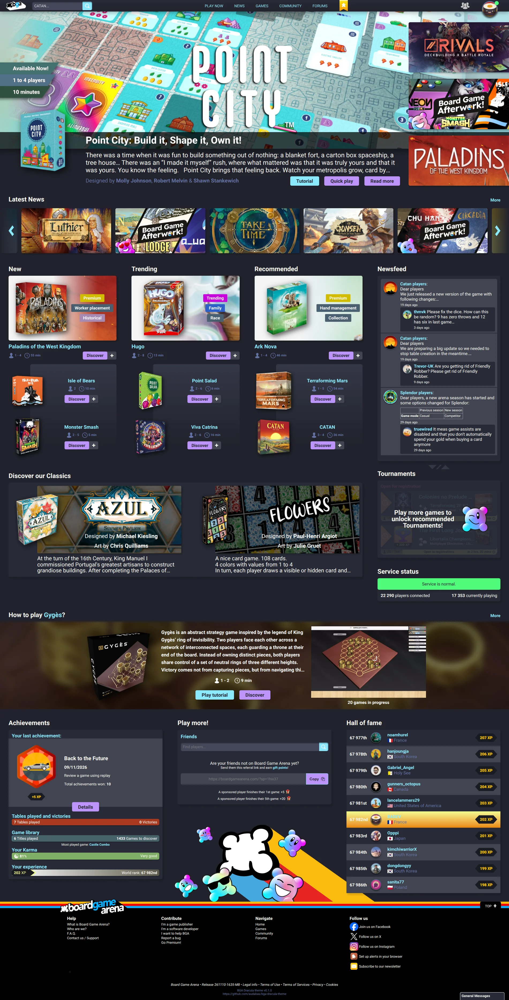
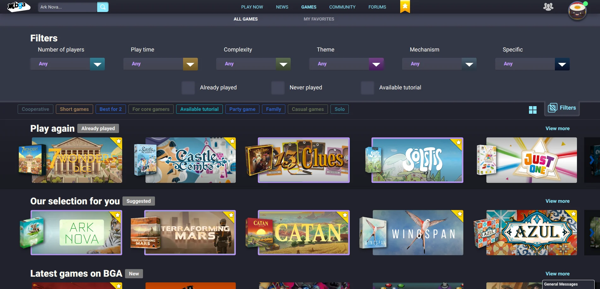
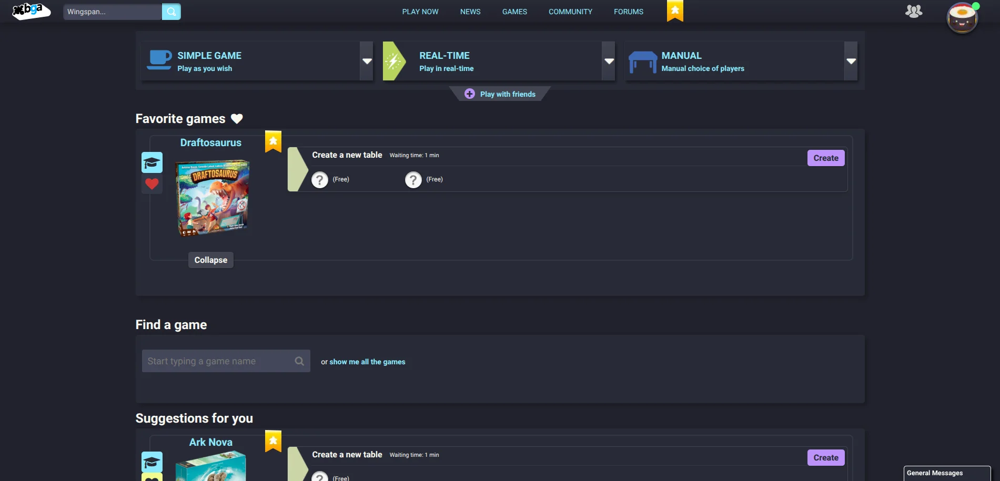
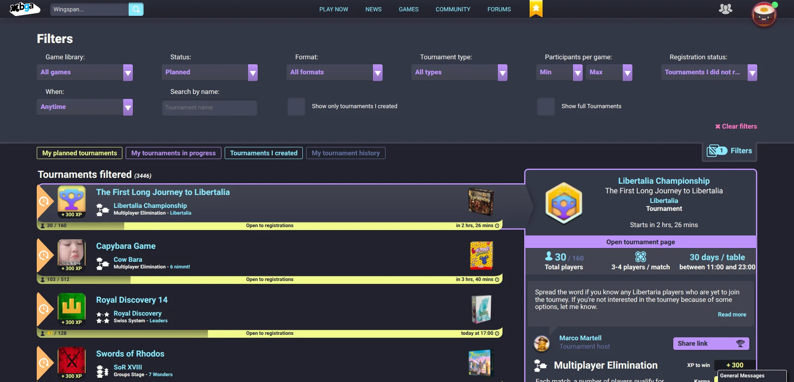
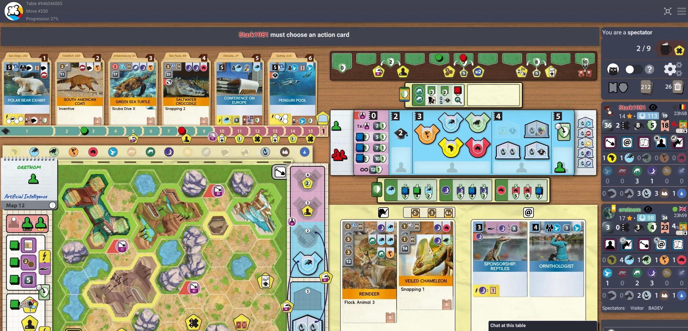

# BGA Dracula Theme

A [Dracula](https://draculatheme.com/) css theme for [boardgamearena.com](https://boardgamearena.com/),
built on top of BGA's [official dark theme](https://boardgamearena.com/forum/viewtopic.php?p=259278#p259278).

## Installation :

- Enable BGA's official dark theme
- Go to Preferences -> Advanced (or open this link : https://boardgamearena.com/preferences?section=advanced)
- Copy paste the content of [dist/style.css](https://raw.githubusercontent.com/audabas/bga-dracula-theme/main/dist/style.css) in the textbox and save
- Close and reopen BGA

## Updating :

When a purple notice saying a new version is available shows at the bottom of the homepage or of
Preferences -> Advanced, paste the latest [dist/style.css](https://raw.githubusercontent.com/audabas/bga-dracula-theme/main/dist/style.css)
again, replacing the old one. The installed version is shown at the bottom of BGA pages and on the
first line of the pasted CSS.

Privacy: to show this notice, your browser loads a small image from GitHub Pages on those two pages
(so GitHub sees your IP address).

## Screenshots :

### Homepage

### Game selection

### Lobby

### Tournament

### In-game


## Development :

```bash
npm install
npm run build   # compiles src/style.scss into dist/style.css and checks BGA's size limit
npm run watch   # rebuilds on change
```
